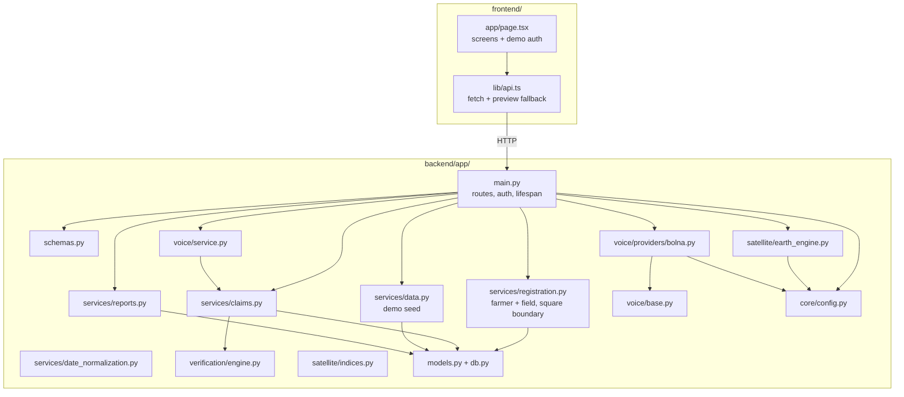

# Component Map

Components, what each owns, and what each may depend on. Last reviewed: 2026-10-29.

## Responsibilities

| Component | Owns | Must not |
|---|---|---|
| `main.py` | Routes, auth dependencies, startup, response shaping | Contain estimator or rule logic |
| `services/claims.py` | Claim creation, verification orchestration, audit entries | Call providers directly |
| `services/registration.py` | Phone normalisation, field id generation, square boundary, atomic farmer+field creation | Decide claim outcomes |
| `verification/engine.py` | Estimator and review rule (pure) | Touch the database or network |
| `satellite/earth_engine.py` | All Earth Engine calls | Return fabricated values |
| `voice/service.py` | Voice-flow operations on top of claims | Contain vendor-specific payloads |
| `voice/providers/bolna.py` | Bolna HTTP format and event normalization | Be imported by services |
| `services/data.py` | Synthetic demo dataset | Run outside demo mode |
| `services/reports.py` | PDF layout | Make decisions |
| `models.py`, `db.py` | Schema and session handling | Hold business rules |
| `core/config.py` | Settings from environment / `.env` | Hold secrets in code |
| `frontend/lib/api.ts` | HTTP calls, preview fallback data | Decide claim outcomes |
| `frontend/app/page.tsx` | All screens, demo sign-in | Hold credentials |

## Dependency rules

1. Dependencies point downward: routes → services → domain/models. The domain engine imports nothing from the app.
2. Vendor code stays behind an interface or adapter (`voice/base.py`, `satellite/`).
3. The frontend only talks to the API; it never reaches providers.
4. Secrets are read only in `core/config.py` and used only in adapters.

Known deviation: `main.py` instantiates `BaselineGreenupEstimator` directly in the satellite-analysis route and calls `fetch_sentinel2_observations` itself instead of going through a service. It is the one place routes touch the engine and the adapter together.

`satellite/indices.py` was not reviewed for this document: TBD.
