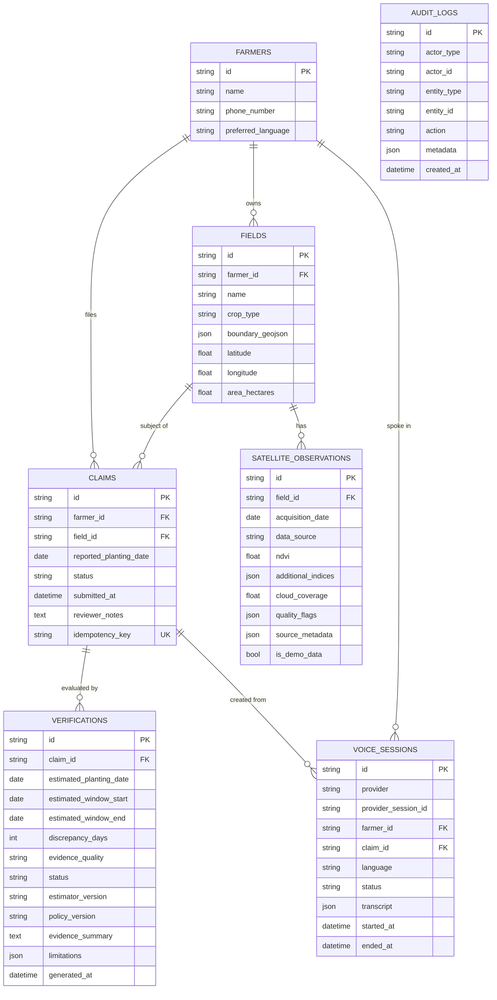

# Database Schema

Source of truth: `backend/app/models.py`; migration `backend/alembic/versions/0001_initial_schema.py`. Last reviewed: 2026-10-29. Databases: SQLite (local) or PostgreSQL 16 (Compose). JSON columns use SQLAlchemy `JSON`.

`audit_logs` has no foreign keys by design: `entity_type` and `entity_id` point loosely at any record.

## Tables

### farmers
`id` (string 64, UUID default), `name` (160, required), `phone_number` (32, nullable), `preferred_language` (16, default `en`; API accepts `en`, `hi`, `mr`), `created_at`, `updated_at`.

### fields
`id` (string 64, caller-supplied, pattern `^[A-Za-z0-9-]{3,64}$`), `farmer_id` → farmers (RESTRICT, indexed), `name`, `crop_type`, `boundary_geojson` (Polygon or MultiPolygon, WGS 84), `latitude`, `longitude`, `area_hectares` (> 0), timestamps. Deleting a field deletes its observations (cascade).

### claims
`id` (UUID or `CLM-<field>` for seeds), `farmer_id` and `field_id` (both RESTRICT, indexed), `reported_planting_date`, `status` (default `PENDING`), `submitted_at`, `reviewer_notes`, `idempotency_key` (unique, nullable), timestamps. Index `ix_claim_status_submitted (status, submitted_at)`.

Status values: `PENDING`, `WITHIN_TOLERANCE`, `REVIEW_REQUIRED`, `INSUFFICIENT_EVIDENCE`, `HUMAN_REVIEW`. Not enforced by a database constraint; enforced in the API schema only for the review endpoint.

### satellite_observations
Unique `(field_id, acquisition_date, data_source)`. `ndvi` nullable; `cloud_coverage` is a percentage (scene-level for Earth Engine). `is_demo_data` separates synthetic from real rows. Seeded rows use `data_source = SYNTHETIC_DEMO_SERIES`; live rows use `COPERNICUS/S2_SR_HARMONIZED`.

### verifications
One row per verification run; many per claim. Keeps estimator and policy versions so old results stay interpretable. Deleted with the claim (cascade).

### voice_sessions
Unique `(provider, provider_session_id)`. `provider` is `bolna` or `simulator`. `claim_id` is set by the simulator, and for real calls by `link_voice_session` (matching the claim key `voice:<provider_session_id>`, in either order). It stays empty when no claim was made during the call or the agent used a different `session_id`.

### audit_logs
Append-only by convention. Actions in use: `claim.created`, `claim.verified`, `voice.simulated`, `voice.webhook.processed`.

## Constraints worth knowing

- `farmers.phone_number` is stored as `+` and digits and is unique **by application check only** (`register_farm`), not by a database constraint; `farmers.phone_number` is nullable because seeded demo farmers have none. A unique index would need a migration.
- A claim cannot be created for a field that does not belong to the stated farmer (service-level check).
- No constraint prevents several claims for the same field and season. TBD.
- `geoalchemy2` is a declared dependency, but boundaries are stored as plain JSON, not as PostGIS geometry.

## Seed data (demo mode)

| Field | Farmer | Reported date | Observations | Expected outcome |
|---|---|---|---|---|
| TX-001 | Alma Torres (`F-ALMA`) | 2025-05-25 | 7 | `WITHIN_TOLERANCE` |
| TX-002 | Nora Bennett (`F-NORA`) | 2025-07-04 | 7 | `REVIEW_REQUIRED` |
| TX-003 | Dev Shah (`F-DEV`, `hi`) | 2025-05-31 | 1 (58% cloud) | `INSUFFICIENT_EVIDENCE` |
