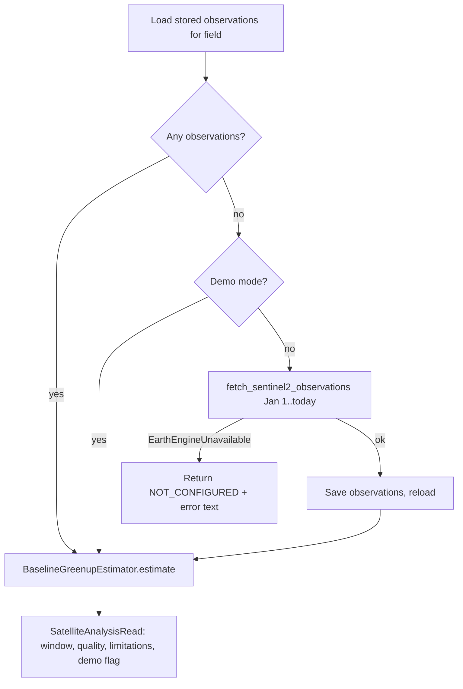
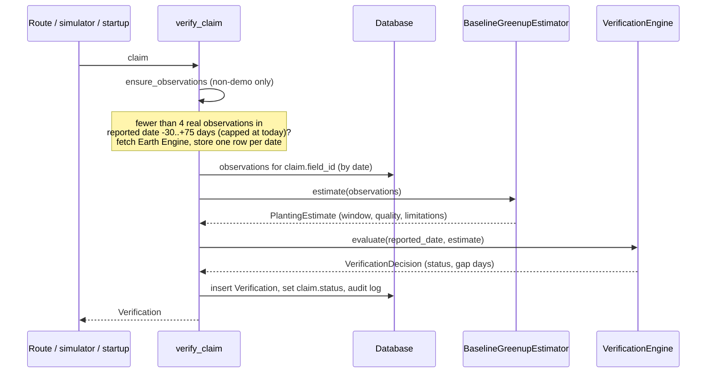

# Code Flow

How the code actually executes, per entry point. Last reviewed: 2026-10-29. Paths are under `backend/app/` unless stated.

## 1. Startup — `main.py` `lifespan`

1. `Base.metadata.create_all(engine)` creates tables.
2. If `AGRIVERIFY_DEMO_MODE`: `seed_demo_data` (skipped if any field exists), then `verify_claim` for every `PENDING` claim.
3. In non-demo mode nothing is seeded and no claim is verified at startup.

## 2. Dashboard reads

`GET /dashboard/summary`, `/farmers`, `/fields`, `/claims`, `/claims/{id}`, `/verifications/{id}`, `/voice/sessions`: protected by `dashboard_auth` (checks `X-API-Key` only when `API_KEY` is set), then a direct query through `get_db`.

## 3. Satellite analysis — `GET /fields/{id}/satellite-analysis`



## 3a. Registration — `POST /registrations`

`services/registration.py` `register_farm`: if `farmer_id` is given, load that farmer (`LookupError` becomes 404); otherwise normalise the phone number, refuse a number already on a farmer (`DuplicateFarmer` becomes 409), and create the farmer. Then generate an unused `FLD-xxxxxx` id, build the square boundary from latitude, longitude and area, insert the field, write a `farm.registered` audit entry, and commit. Nothing is saved if any step fails. Frontend: the **Register Farm** screen posts the form, then does a quiet refresh so the new farmer and field appear in the dropdowns without a loading flash.

## 4. Claim creation — `services/claims.py` `create_claim`

1. If an idempotency key is given and a claim with it exists, return that claim.
2. Check the field exists and belongs to the farmer (`ValueError` becomes HTTP 422).
3. `check_reported_date`: reject a future date; outside demo mode also reject a date older than `MAX_PLANTING_AGE_DAYS` and a second claim for the same field and planting year (see [decision.md](decision.md) D12). Each is a `ValueError` with a message the voice agent can relay.
4. Insert `Claim(status=PENDING)`, write `claim.created` audit log, commit.

Entry points: `POST /claims` (dashboard, key from body or `Idempotency-Key` header) and `create_voice_claim` (key `voice:<session_id>`).

## 5. Verification — `services/claims.py` `verify_claim`



`ensure_observations` (`services/claims.py`) skips entirely in demo mode. Otherwise it fetches only when the window holds fewer than 4 real observations, stores new dates (best cloud cover wins when two scenes share a date) and returns an error message on failure. A failure, or a future-dated claim, is placed first in the verification's `limitations`; the estimator then runs on whatever is stored and normally yields `INSUFFICIENT_EVIDENCE`. Fake data is never substituted.

## 6. Voice call (target flow with Bolna)

```mermaid
sequenceDiagram
    participant F as Farmer
    participant B as Bolna agent
    participant A as FastAPI
    F->>B: phone call
    B->>F: asks farm ID, crop, planting date; confirms
    B->>A: POST /voice/tools/lookup-field
    A-->>B: farm, crop, farmer id
    B->>A: POST /voice/tools/create-claim (session_id)
    A-->>B: claim_id, PENDING
    B->>A: POST /voice/tools/run-verification (session_id)
    A-->>B: status, evidence quality, summary
    B->>F: explains result; may request human review
    B->>A: POST /voice/webhooks/bolna (transcript, status)
    A-->>B: accepted
```

Details:
- `lookup-field`: `farm_id` upper-cased and looked up; 404 if missing.
- `create-claim`: 422 without `planting_date`; `create_voice_claim` rejects a crop that differs from the field's.
- `run-verification`: requires `session_id`; finds the claim by key `voice:<session_id>`; calls `verify_claim`.
- `request-human-review?claim_id=`: sets status `HUMAN_REVIEW`.
- Webhook: optional `X-Webhook-Secret` check, `normalize_event`, then `process_webhook` upserts the `VoiceSession` and writes an audit entry. The session is not linked to the claim here.
- These tool routes have no authentication.

Not implemented: starting an outbound call (`initiate_call` has no caller).

## 7. Text simulator — `POST /voice/simulator`

`simulate_intake`: look up field, create a `VoiceSession(provider="simulator")` with a canned transcript, `create_voice_claim`, link `session.claim_id`, `verify_claim`, write `voice.simulated` audit log, return mode `SIMULATION`.

## 8. Reports — `GET /reports/{claim_id}/pdf`

Load claim, newest verification (409 if none), all field observations, then `build_verification_pdf` and stream it inline.

## 9. Reviewer note — `PATCH /claims/{id}/review`

Sets `reviewer_notes`, and `status` if supplied. No audit log entry is written here.

## 10. Frontend

`page.tsx` → `AgriVerifyApp` reads `localStorage` for the demo session → `PhoneAuth` (code `246810`) or `Dashboard`. `Dashboard.refresh` calls summary, fields and claims in parallel through `lib/api.ts`; any failure switches that response to bundled preview data and shows a banner. The satellite screen re-fetches analysis when the selected field changes. The calls screen posts to `/voice/simulator` and then refreshes.
