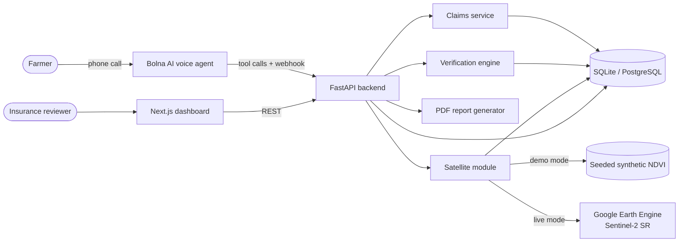

# System Architecture Document

Last reviewed: 2026-10-29.

## Application boundaries

The Next.js dashboard is an API consumer. It shows an explicit static, synthetic preview only when the local API is unavailable. The FastAPI service owns all business rules, database transactions, PDF generation and external provider calls. This prevents client-side claim decisions and keeps credentials out of the browser.

## System diagram

## Layers

| Layer | Responsibility |
|---|---|
| Presentation (`frontend/`) | Dashboard screens, charts, simulator form. Holds no business rules. |
| API (`backend/app/main.py`) | Routing, request validation, auth checks, wiring. |
| Services (`backend/app/services/`) | Claim creation, claim verification, demo seeding, PDF report, date normalization. |
| Domain (`backend/app/verification/`) | Planting-window estimator and review rule. Pure functions over observations. |
| Integrations (`backend/app/satellite/`, `backend/app/voice/`) | Earth Engine adapter; provider-neutral voice interface and Bolna adapter. |
| Persistence (`backend/app/models.py`, `db.py`, `alembic/`) | SQLAlchemy models and migration. |

## Data model

`Farmer` owns `Field` records; a `Claim` links a farmer, a field and the farmer-reported date. `SatelliteObservation` stores the time series and its provenance. Each verification execution produces a `Verification` record that persists the estimator version, policy version, evidence grade, interval and limitations. `VoiceSession` and `AuditLog` preserve event history. See [database-schema.md](database-schema.md).

The startup path creates tables for local demo convenience. `alembic/versions/0001_initial_schema.py` gives the schema a migration path for managed database deployments.

## Verification flow

1. The field's cloud-screened observations are sorted by acquisition date.
2. The baseline estimator finds a vegetation threshold relative to early observations, then applies a documented 4–14 day emergence-lag interval.
3. The reported date is evaluated against the interval. A date inside it has a zero interval gap; a date outside it is measured to the nearest interval boundary.
4. The configurable seven-day illustrative tolerance produces `WITHIN_TOLERANCE` or `REVIEW_REQUIRED`; inadequate data always produces `INSUFFICIENT_EVIDENCE`.

No LLM can approve, reject or decide a claim. The voice layer only collects and confirms data before invoking deterministic backend operations. Step-by-step call paths are in [flow.md](flow.md).

## Satellite processing

In demo mode, a known synthetic dataset is persisted with a provenance flag. In non-demo mode the Earth Engine adapter initializes either from explicit service-account settings or from credentials stored by `earthengine authenticate` (no key file needed). It converts the GeoJSON field boundary to an `ee.Geometry`, requests `COPERNICUS/S2_SR_HARMONIZED`, masks QA60 cloud/cirrus bits, scales surface reflectance, calculates NDVI from B8 and B4, and aggregates field means at 10 m. Cloud and provider failures are returned as a not-configured/error state, never as simulated observations.

NDVI is `(NIR - Red) / (NIR + Red)`; the adapter also computes SAVI as a supporting soil-adjusted index. NDVI green-up alone is not planting proof.

## Voice provider boundary

`VoiceProvider` expresses only provider-neutral operations: start a call, retrieve a session and normalize event data. `BolnaVoiceProvider` owns the HTTP format and Bearer credential. Webhook payloads normalize to `VoiceSession` and use a `(provider, provider_session_id)` unique constraint for idempotency. The text simulator calls `create_voice_claim` and `verify_claim` directly and is visibly labelled simulation.

## Deployment model

| Mode | Components |
|---|---|
| Local | `uvicorn` on :8000 with SQLite, `next dev` on :3000. |
| Docker Compose | `api` (:8000), `frontend` (:3000), `db` (PostgreSQL 16, :5432). |
| Production | TBD. Needs public HTTPS for Bolna webhooks, secret management, managed database. |

## Non-functional requirements

| Area | Current state |
|---|---|
| Reliability | Demo mode needs no external service. Live integrations fail closed with a visible state. |
| Auditability | Estimator and policy versions stored per verification; `audit_logs` for claim, voice and verification events. |
| Idempotency | Claim creation by idempotency key; webhook by provider session id. |
| Performance | No targets set. Earth Engine calls are synchronous inside the request. TBD. |
| Security | See below. |

## Security posture

The browser does not receive Earth Engine or Bolna secrets. Optional `API_KEY` protects dashboard endpoints; a configured custom webhook value is checked in an `X-Webhook-Secret` header. **The voice tool endpoints (`lookup-field`, `create-claim`, `run-verification`, `request-human-review`) currently have no authentication.** In a genuine deployment, put the service behind identity-aware authentication, HTTPS, IP/network controls, centralized audit logging, secret management, retention controls and a reviewed authorization model before handling real farmer data.
