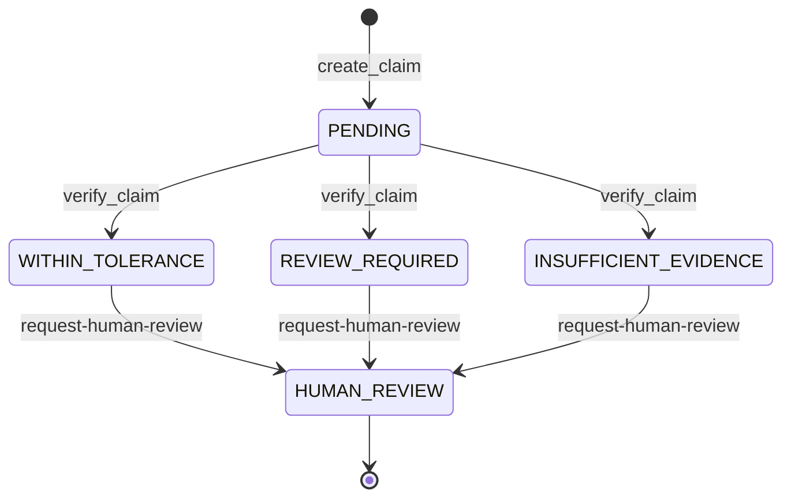

# Technical Design Document

Last reviewed: 2026-10-29. Chronological decisions and their reasoning are in [decision.md](decision.md).

## 1. Planting-window estimator

`BaselineGreenupEstimator` (`backend/app/verification/engine.py`, version `baseline-greenup-window-v1`).

1. Keep observations with an NDVI value and cloud coverage `<= 35` (or unknown), sorted by date.
2. If fewer than 4 remain: `INSUFFICIENT_EVIDENCE`, no window.
3. Baseline = mean NDVI of the first 3 usable observations. Threshold = baseline + 0.08.
4. Green-up = first observation, from the third onward, with NDVI `>= threshold`. If none: `WEAK_EVIDENCE`, no window.
5. Window = `[green-up − 14 days, green-up − 4 days]`; midpoint = start + 5 days. This is an intentionally broad cotton emergence lag.
6. Evidence quality: `STRONG_EVIDENCE` if at least 6 usable observations and all have cloud `<= 20`; otherwise `MODERATE_EVIDENCE`.

All constants are uncalibrated guesses. There is no confidence percentage by design.

## 2. Review rule

`VerificationEngine` (version `review-policy-v1`), tolerance from `VERIFICATION_TOLERANCE_DAYS`.

| Condition | Status | `discrepancy_days` |
|---|---|---|
| No window | `INSUFFICIENT_EVIDENCE` | none |
| Reported date inside window | `WITHIN_TOLERANCE` | 0 |
| Outside window, gap `<= tolerance` | `WITHIN_TOLERANCE` | gap |
| Outside window, gap `> tolerance` | `REVIEW_REQUIRED` | gap |

`verify_claim` passes `VERIFICATION_TOLERANCE_DAYS` (default 7) into the engine on every run, so a setting change applies to the next verification. Old `Verification` rows keep the outcome they were computed with.

## 3. Claim lifecycle

Re-running `verify_claim` adds a new `Verification` row and overwrites `claim.status`. The reviewer endpoint can set any status.

## 4. Satellite adapter

`fetch_sentinel2_observations` (`backend/app/satellite/earth_engine.py`) returns one row per image: date, field-mean NDVI and SAVI, scene cloud percentage. Scene filter: `CLOUDY_PIXEL_PERCENTAGE < 60`; pixel mask: QA60 bits 10 and 11. Any failure raises `EarthEngineUnavailable`; callers must surface it, never substitute demo data.

Authentication: service-account key if all three of project, account and key JSON are set; otherwise application credentials from `earthengine authenticate`. The adapter is considered configured when `EARTH_ENGINE_PROJECT` is set.

## 5. Voice design

- Tool endpoints are plain JSON POSTs designed to be configured as Bolna custom function tools.
- Identification: `lookup-farmer` matches the caller's number (normalised to `+` and digits) to `farmers.phone_number`. `create-claim` requires that number and rejects a field belonging to a different farmer. Tool names in the agent prompt match the endpoints: `lookup_farmer`, `create_claim`, `run_verification`, `request_human_review`.
- `create-claim` rejects a crop that differs from the field record and requires a date.
- Idempotency: claim key `voice:<session_id>`; webhook key `(provider, provider_session_id)`.
- Bolna's execution payload is normalized to `{provider_session_id, status, transcript, language, raw}`.
- `normalize_confirmed_date` is called by `create-claim`. It rejects dates without a year and numeric dates that read two ways (both parts 12 or below and different, such as `05/06/2025`), because US and Indian orderings differ.
- A voice session is linked to its claim by the shared id: claims are stored under `voice:<session_id>` and the webhook carries the provider's call id. This holds only if the agent passes the platform's call id as `session_id`.

## 6. Frontend design

Single-page Next.js app. A signed-in state (demo phone sign-in, stored in `localStorage`) gates a dashboard with seven screens. Data comes from `lib/api.ts`; each call falls back to bundled static data when the API is unreachable and marks the page as a preview.

## 7. Known technical gaps

1. ~~`verify_claim` reads only stored observations.~~ Fixed 2026-10-29: `verify_claim` now fetches a window around the reported date (see [decision.md](decision.md) D11). The satellite-analysis endpoint still fetches Jan 1 to today when a field has no observations.
2. ~~Voice tool endpoints are unauthenticated.~~ Fixed 2026-10-29: they require the webhook secret when one is configured. They remain open when it is unset.
3. `initiate_call` and `retrieve_call` are never called by a route.
4. ~~The voice session is not linked to the claim for real calls.~~ Fixed 2026-10-29 (see section 5); depends on the agent's `session_id` being the platform call id.
5. ~~The tolerance setting is not wired into the engine.~~ Fixed 2026-10-29.
6. The frontend does not send `X-API-Key`; PDF links are hardcoded to `localhost:8000`.
