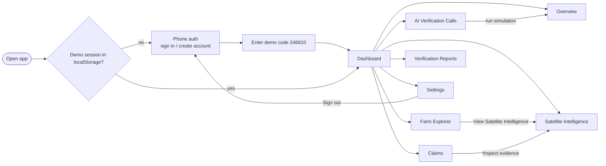

# UI/UX Flows and Wireframes

Source: `frontend/app/page.tsx`. Last reviewed: 2026-10-29. Wireframes are schematic.

## Navigation flow



## Layout

```
┌───────────────┬──────────────────────────────────────────────┐
│ ▣ AgriVerify  │ eyebrow            [● LOCAL API CONNECTED /  │
│               │ Screen title        STATIC PREVIEW — API OFF]│
│ Overview      │ ──────────────────────────────────────────── │
│ Farm Explorer │ [preview-data notice, when API is unreachable]│
│ Satellite…    │                                              │
│ Claims        │                 screen content               │
│ AI Verif…Calls│                                              │
│ Reports       │                                              │
│ Settings      │                                              │
│ ───────────── │                                              │
│ Human decision│                                              │
│ support only  │                                              │
└───────────────┴──────────────────────────────────────────────┘
```

## Screens

### Phone auth
Choose sign in or create account → phone (8–15 digits) and, for sign-up, name (≥2 chars) → six-digit code. **Demo only:** the code is fixed (`246810`) and nothing is sent; the session is stored in the browser.

### Overview
Four metric cards (registered farms, submitted claims, within tolerance, needs investigation); verification-activity area chart (illustrative, hardcoded points); status-distribution donut; recent-activity list; review-queue count with a button to Claims.

### Farm Explorer
Left: 2D fallback map card (field shape, marker, coordinates, "Cesium globe not enabled" label). Right: field card (id, name, crop, area, latest claim and status, "Synthetic demo field" tag, button to Satellite Intelligence). Below: list of registered fields.

### Satellite Intelligence
Field selector (hardcoded TX-001..003). Notice stating whether data is synthetic or Earth Engine. NDVI/SAVI area chart; card with evidence quality, data source, processing status, reported date, estimated window, first limitation; observation timeline.

### Claims
Search box, status filter, table (claim, farm, reported planting, status, "Inspect evidence"). Empty state: "No claims match this filter."

### AI Verification Calls
"Text simulator" tag and notice that it is not a live call. Form: farm (TX-001..003), crop (fixed Cotton), planting date, language (English, Hindi and Marathi flagged as needing live validation), "Run intake simulation". Result line with claim id and status. Example transcript beside it.

### Verification Reports
Table of claims with "Open local PDF" links (hardcoded to `http://localhost:8000`).

### Settings
Integration status rows (demo dataset, voice AI, satellite, access control) and Sign out.

## States

| State | Behaviour |
|---|---|
| Loading | Centered "Preparing AgriVerify" card; per-screen "Loading analysis…" |
| API offline | Banner, "STATIC PREVIEW" badge, bundled synthetic data |
| Empty | Text empty states on lists |
| Error | Simulator shows the error message; other screens fall back to preview data |

## Status colours

`WITHIN_TOLERANCE` green, `REVIEW_REQUIRED` amber, `INSUFFICIENT_EVIDENCE` red, `PENDING` and `HUMAN_REVIEW` blue.

## Missing screens (TBD)

Register farmer and field (with boundary drawing); claim detail with reviewer notes and status actions; real sign-in; accessibility review (keyboard, contrast, labels) not yet done.
